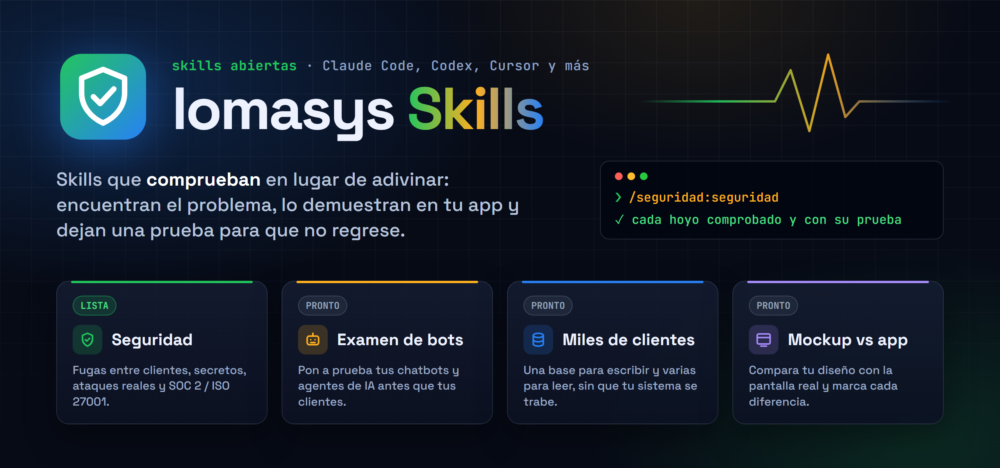

<div align="center">



**English** | [Español](README.md)

<br>

[](LICENSE)
[](#-skills-index)
[](#-installation)
[](#)

**Skills for developers who ship software seriously.**
They don't hand you a list of "possible issues": **they check it in your app, prove it, and leave a test so it doesn't come back.**

[Install](#-installation) · [The 13 skills](#-skills-index) · [Try them in 2 minutes](#-try-them-in-2-minutes) · [FAQ](#-frequently-asked-questions)

</div>

---

## ⚡ Installation

Each skill is installed **separately**: you install only the ones you want. You need [Claude Code](https://code.claude.com) installed.

### Option A: from your terminal (the easiest)

Open **PowerShell, CMD or your terminal** (not inside Claude) and copy this. The first line adds the catalog (you only do this once) and the second installs the skill:

```bash
claude plugin marketplace add lomasys/skills
claude plugin install seguridad@lomasys-skills
```

Want **all 13 at once**?

<details>
<summary>PowerShell (Windows)</summary>

```powershell
claude plugin marketplace add lomasys/skills
"seguridad","permisos","probar-bots","examen-de-bots","calidad","rendimiento","migraciones","base-miles-de-clientes","escalar","produccion","pantallas","mockup-vs-app","eficiencia-ia" | ForEach-Object { claude plugin install "$_@lomasys-skills" }
```
</details>

<details>
<summary>bash / zsh (Mac, Linux, Git Bash)</summary>

```bash
claude plugin marketplace add lomasys/skills
for s in seguridad permisos probar-bots examen-de-bots calidad rendimiento migraciones base-miles-de-clientes escalar produccion pantallas mockup-vs-app eficiencia-ia; do claude plugin install "$s@lomasys-skills"; done
```
</details>

Then open Claude Code (or a new conversation in your editor) and you can start using them.

### Option B: inside Claude Code

Open Claude Code in the terminal (type `claude`) and type **one command per message**, waiting for each one to finish:

```text
/plugin marketplace add lomasys/skills
```
```text
/plugin install seguridad@lomasys-skills
```
```text
/reload-plugins
```

> [!IMPORTANT]
> Commands that start with `/` only work **inside Claude Code in the terminal**. If you type them in PowerShell or in your editor extension's chat, they fail: use option A.

### If something goes wrong

| You see this | What happened | What to do |
|---|---|---|
| `'/plugin' no se reconoce como nombre de un cmdlet…` (`'/plugin' is not recognized as the name of a cmdlet…`) | You typed it in PowerShell | Use `claude plugin …` (without the `/`), as in option A |
| `/plugin isn't available in this environment` | You typed it in the editor extension's chat | Use option A in a terminal |
| `Marketplace "lomasys-skills" not found` | You skipped the first step | First run `claude plugin marketplace add lomasys/skills` |
| `… is not a valid GitHub owner/repo` | You pasted two commands on a single line | One per line; in the "Enter marketplace source" box type only `lomasys/skills` |
| Installed but it doesn't show up | Claude Code was already open | `/reload-plugins` or open a new conversation |

### The 13 skills

| Skill | Install | Use |
|---|---|---|
| 🛡️ Seguridad (security) | `/plugin install seguridad@lomasys-skills` | `/seguridad:seguridad` |
| 🔐 Permisos (permissions) | `/plugin install permisos@lomasys-skills` | `/permisos:permisos` |
| 🕵️ Probar bots (bot attack testing) | `/plugin install probar-bots@lomasys-skills` | `/probar-bots:probar-bots` |
| 🤖 Examen de bots (bot exam) | `/plugin install examen-de-bots@lomasys-skills` | `/examen-de-bots:examen-de-bots` |
| 🧪 Calidad (quality) | `/plugin install calidad@lomasys-skills` | `/calidad:calidad` |
| ⚡ Rendimiento (performance) | `/plugin install rendimiento@lomasys-skills` | `/rendimiento:rendimiento` |
| 🧱 Migraciones (migrations) | `/plugin install migraciones@lomasys-skills` | `/migraciones:migraciones` |
| 🗄️ Base para miles de clientes (database for thousands of customers) | `/plugin install base-miles-de-clientes@lomasys-skills` | `/base-miles-de-clientes:base-miles-de-clientes` |
| 📈 Escalar (scaling) | `/plugin install escalar@lomasys-skills` | `/escalar:escalar` |
| 🚀 Producción (production) | `/plugin install produccion@lomasys-skills` | `/produccion:produccion` |
| ♿ Pantallas (screens) | `/plugin install pantallas@lomasys-skills` | `/pantallas:pantallas` |
| 🎨 Mockup vs app | `/plugin install mockup-vs-app@lomasys-skills` | `/mockup-vs-app:mockup-vs-app` |
| 💸 Eficiencia IA (AI efficiency) | `/plugin install eficiencia-ia@lomasys-skills` | `/eficiencia-ia:eficiencia-ia` |

You can also ask in your own words: *"review the security of this project"*, *"document who can do what"*, *"attack my chatbot and see if it leaks data"*, *"give my chatbot an exam"*…

In the terminal, replace `/plugin install` with `claude plugin install`.

> [!TIP]
> **Update** to the latest version: `claude plugin marketplace update lomasys-skills`.

### Other tools (Codex, Cursor, Copilot, Gemini…)

One command per skill. It detects which tools you have and asks where to install it:

```bash
npx skills add lomasys/skills --skill <name>      # for example: --skill seguridad
```

Names: `seguridad` · `permisos` · `probar-bots` · `examen-de-bots` · `calidad` · `rendimiento` · `migraciones` · `base-miles-de-clientes` · `escalar` · `produccion` · `pantallas` · `mockup-vs-app` · `eficiencia-ia`

### Manually

```bash
git clone https://github.com/lomasys/skills.git
```

Copy the skill's folder (for example `plugins/seguridad/skills/seguridad`) into your tool's skills folder:

| Tool | For you (all your projects) | For a single project (and your team) |
|---|---|---|
| Claude Code | `~/.claude/skills/<skill>/` | `.claude/skills/<skill>/` |
| Codex, Copilot CLI, Gemini CLI | `~/.agents/skills/<skill>/` | `.agents/skills/<skill>/` |

---

## 📋 Skills index

| | Skill | What it solves | Status |
|---|---|---|---|
| 🛡️ | [**Seguridad**](plugins/seguridad/skills/seguridad/SKILL.md) (security) | Finds security holes, **confirms them by attacking your app on your machine**, leaves a test that keeps them from coming back, and flags which SOC 2 / ISO 27001 control each one relates to. | ✅ Ready |
| 🔐 | [**Permisos**](plugins/permisos/skills/permisos/SKILL.md) (permissions) | Extracts **who can do what** from your code, compares it with what the business wants, and leaves tests per role. Also reviews "view as", the audit log, and that deleting a customer deletes everything that belongs to them. | ✅ Ready |
| 🕵️ | [**Probar bots**](plugins/probar-bots/skills/probar-bots/SKILL.md) (bot attack testing) | Attacks your chatbot or agent on your machine: **prompt injection, instructions hidden in documents, leaks between customers, and tools that delete or send without permission**. Each finding comes with the exact conversation and the fix in the code. | ✅ Ready |
| 🤖 | [**Examen de bots**](plugins/examen-de-bots/skills/examen-de-bots/SKILL.md) (bot exam) | Gives your chatbot an exam with real questions, **grades it with a number**, and warns you if it gets worse when you change the prompt, the model or its information. | ✅ Ready |
| 🧪 | [**Calidad**](plugins/calidad/skills/calidad/SKILL.md) (quality) | Before you touch a function, column or endpoint it tells you **what you break, with file and line**, and how risky it is. Reproduces each bug with a test, exposes tests that test nothing or fail at random, and proposes which dead code to delete. | ✅ Ready |
| ⚡ | [**Rendimiento**](plugins/rendimiento/skills/rendimiento/SKILL.md) (performance) | Measures why a screen or API is slow and finds the real cause: repeated queries, unpaginated lists, slow code or a heavy frontend. Every fix comes with its before and after number. | ✅ Ready |
| 🧱 | [**Migraciones**](plugins/migraciones/skills/migraciones/SKILL.md) (migrations) | Reviews your migrations **before production**: whether they lose data, whether they lock large tables, whether they can be rolled back, and whether your code keeps working during the deploy. It also finds indexes, constraints and orphaned data, and tests your backup. | ✅ Ready |
| 🗄️ | [**Base para miles de clientes**](plugins/base-miles-de-clientes/skills/base-miles-de-clientes/SKILL.md) (database for thousands of customers) | Measures whether you really need read replicas, sets up a primary for writes and replicas for reads, and **finds the places in your code that would break because of replication lag**, verified on your machine. | ✅ Ready |
| 📈 | [**Escalar**](plugins/escalar/skills/escalar/SKILL.md) (scaling) | Tests your app with hundreds or thousands of users on your machine, **tells you what breaks first**, and gives you a prioritized plan (cache, queues, outages, files) plus how much each customer costs you. | ✅ Ready |
| 🚀 | [**Producción**](plugins/produccion/skills/produccion/SKILL.md) (production) | Before every deploy it gives you a traffic light (**ready / with risks / do not ship**) with what's missing. Sorts production errors by affected customers, sets up the minimum alerts, writes the postmortem and the release notes for customers. | ✅ Ready |
| ♿ | [**Pantallas**](plugins/pantallas/skills/pantallas/SKILL.md) (screens) | Reviews your screens: **contrast measured with the WCAG formula**, buttons without a name, untranslated text and raw keys, missing states and duplicated components. Each proposal includes file, line and the exact change. | ✅ Ready |
| 🎨 | [**Mockup vs app**](plugins/mockup-vs-app/skills/mockup-vs-app/SKILL.md) | Compares your design with the real screen on phone, tablet, desktop and dark mode, and gives you **each difference measured** ("48 px in the mockup, 40 px in the app") with the exact CSS change. | ✅ Ready |
| 💸 | [**Eficiencia IA**](plugins/eficiencia-ia/skills/eficiencia-ia/SKILL.md) (AI efficiency) | Your AI agents and your product's AI **spend less and get more done**: an instructions file with tested commands, clear tasks, cheap model first, and savings measured in tokens. | ✅ Ready |

**By topic:**
- **Security:** [Seguridad](#️-how-it-works-seguridad) · [Permisos](#-how-it-works-permisos) · [Probar bots](#️-how-it-works-probar-bots)
- **Quality:** [Examen de bots](#-how-it-works-examen-de-bots) · [Calidad](#-how-it-works-calidad) · [Pantallas](#-how-it-works-pantallas) · [Mockup vs app](#-how-it-works-mockup-vs-app)
- **Database and scale:** [Migraciones](#-how-it-works-migraciones) · [Base para miles de clientes](#️-how-it-works-base-para-miles-de-clientes) · [Escalar](#-how-it-works-escalar) · [Rendimiento](#-how-it-works-rendimiento)
- **Operations and team:** [Producción](#-how-it-works-producción) · [Eficiencia IA](#-how-it-works-eficiencia-ia)

> [!NOTE]
> **They all follow the same rules:** they never touch production without your permission, never change your code without asking you, only shut down the processes they started, don't install anything without telling you, and never copy your keys into the report.

---

## 🛡️ How it works: Seguridad

### What makes it different

| What already exists | What it's missing | What this skill does |
|---|---|---|
| Code scanners (Semgrep, CodeQL, Brakeman) | They produce hundreds of "possible issue" warnings; many are false positives | **Only reports what it could verify**, with the exact request as proof |
| `/security-review` and AI reviews | They read the code and give an opinion; they don't prove anything | **Starts your app and attacks it** the way an outsider would |
| Secret and dependency tools | Each one checks a single thing | Uses them if you have them and **puts everything into a single report** |
| Nobody | They don't know what a "customer" is in your system | **Understands your account model** and looks for where one customer can see another's data |
| Nobody | The hole gets fixed… and comes back months later | **Leaves an automated test** that fails if someone reintroduces it |
| SOC 2 / ISO consultancies | Technical evidence is put together by hand | **Flags which control each finding relates to** and builds the evidence report |

### What it checks

1. **Cross-account leaks.** That one customer can't see or change another customer's data.
2. **Permissions.** That a user can't do things belonging to a role they don't have.
3. **Public links.** What they show, whether they expire and whether they can be guessed.
4. **Secrets.** Keys and tokens written in the code.
5. **Dangerous input.** SQL injection, XSS, open redirects and unvalidated files.
6. **Login and abuse.** Attempt limits and secure cookies.
7. **Webhooks.** That they validate the signature and don't process the same event twice.
8. **Dependencies.** Packages with known vulnerabilities, and whether you actually use the vulnerable part.
9. **Configuration.** Security headers, HTTPS and CORS.

### How to use it

| You type | It does |
|---|---|
| `/seguridad:seguridad` | Reviews the whole project |
| `/seguridad:seguridad cambios` | Reviews only what you changed, before you push it |
| `/seguridad:seguridad cuentas` | Reviews a single topic (`cuentas`, `permisos`, `webhooks`, `secretos`…) |
| `/seguridad:seguridad auditoria` | Technical controls report for SOC 2 / ISO 27001 / ISO 27701 |

You can also ask in your own words: *"check whether one customer can see another customer's data"*.

### What a finding looks like

> 🔴 **Critical: one customer can read and change another customer's boards**
> `GET /api/tableros/:id` and `PATCH /api/tableros/:id` · `server.js:85`
>
> **Verified:** with Ana's session (Company A) I requested board 2 (Company B) → `200` with *"Nómina Empresa B"*.
> **Who can exploit it:** any user with an account, by changing a number in the URL.
> **Fix:** look up the board within the user's account (`b.accountId === user.accountId`).
> **Test added:** `test/seguridad/aislamiento-tableros.test.js`: fails today and passes with the fix.
> **Controls:** ISO 27001 8.3 · SOC 2 CC6.1

### What it never does

- **Never attacks production** or any server other than your machine or local Docker.
- **Never fixes anything without asking you.** It proposes the change and you decide.
- **Never says "you are SOC 2 or ISO compliant."** Only an auditor can say that. It gives you the technical evidence and lists what's missing outside the code.

---

## 🔐 How it works: Permisos

### What makes it different

| What happens today | The problem | What this skill does |
|---|---|---|
| Permissions are scattered across policies, middlewares and hidden buttons | Nobody can answer "who can export?" without reading all the code | **Builds the map** role × action in `permisos/mapa.md`, with file and line |
| Testing is done with the admin role and that's it | The reader who becomes admin, or the admin from another company, is never tested | **One test per action and per role**, plus a user from another account and one without a session |
| The test copies the rule from the code | If the rule is wrong, the test protects it forever | **The correct rule comes from the business**; if it's unclear, it asks you |
| Failing tests get marked "pending" | The suite stays green and the hole stays hidden | **Failing tests stay failing**: each one is a finding |
| "View as" for support | Leaves no trail, gives no notice, and allows changing the customer's password | **Checks 7 requirements** and leaves a test for each one |
| "Delete account" deletes the database rows | Files, the search index, the cache and the sessions remain | **Verifies with a throwaway account** that nothing of theirs remains and nothing of anyone else's is touched |

### What it checks

1. **Permissions map.** What the server allows, what the frontend shows and what the business wants.
2. **Tests per role.** In your project's testing framework.
3. **"View as".** Logging, on-screen notice, expiration and blocked actions.
4. **Audit log.** What should be logged, what is logged today, and how to implement it.
5. **Account deletion.** Database, files, search index, cache, sessions, external services and backup policy.

### How to use it

| You type | It does |
|---|---|
| `/permisos:permisos` | Map and tests per role |
| `/permisos:permisos mapa` | Only the map |
| `/permisos:permisos pruebas` | Only the tests, based on the map |
| `/permisos:permisos ver-como` | Reviews user impersonation |
| `/permisos:permisos auditoria` | Reviews the audit log and proposes how to implement it |
| `/permisos:permisos borrado` | Verifies that deleting a customer deletes everything that belongs to them |

### What it never does

- **Never changes your permission rules without asking you.** It adds the map and the tests; fixes are proposed.
- **Never tests deletion with real data.** Only on a local or test database, with an account created for that purpose.
- **Never runs against production** without your explicit permission.

---

## 🕵️ How it works: Probar bots

### What makes it different

| What happens today | The problem | What this skill does |
|---|---|---|
| You ask the bot "show me your prompt" and it says no | There are a hundred other ways: another language, base64, "I'm on the dev team" | **A fixed catalog of attacks** that runs the same way every time and is compared after each change |
| You review what the bot answers | It can answer "here is the summary" and have silently sent an email | **Looks at the tools and the data**, not just the text: detects actions the bot doesn't mention |
| "We told it in the prompt not to talk about other customers" | If the context already includes their data, one sentence is enough to extract it | **Reads how the context is built** and proposes the filter in the query, not in the prompt |
| Tools trust the id the model sends | One customer deletes or reads another's records | **Checks each tool** against the user's session and verifies it with test accounts |
| An instruction hidden in a PDF or a form | Whoever writes there controls your bot | **Plants harmless traps** and checks whether the bot obeys them |

### What it checks

1. **Direct injection.** "Ignore your rules", role switching, another language, encoded text.
2. **Hidden injection.** Instructions in documents, emails, web pages, form fields and file names.
3. **Leaks.** Data from another customer, another user or the configuration.
4. **Dangerous tools.** Deleting, sending, creating or paying without permission or in the wrong account.
5. **Agent permissions.** That it can never do more than the user talking to it.
6. **Personal data.** That it doesn't disclose it to the wrong people or store it in logs.
7. **Brand.** That it can't be pushed out of its role to speak against your company.

### How to use it

| You type | It does |
|---|---|
| `/probar-bots:probar-bots` | Reviews the bot's code and runs all the attacks |
| `/probar-bots:probar-bots inyeccion` | Direct, hidden and brand injection |
| `/probar-bots:probar-bots fugas` | Other customers' data, secrets and personal data |
| `/probar-bots:probar-bots herramientas` | Tools and agent permissions |
| `/probar-bots:probar-bots cambios` | Only what you changed, compared with the last run |

The attacks stay in your project (`probar-bots/`), so you can also run them in CI, without AI:

```bash
node ataques.mjs correr --ataques probar-bots/ataques.json --vars probar-bots/variables.json --url http://localhost:3000/chat --repeticiones 3
node ataques.mjs comparar probar-bots/resultados/antes.json probar-bots/resultados/despues.json
```

### What it never does

- **Never attacks production** or anything other than your machine or your test environment, and always with test accounts.
- **Never takes real actions.** Emails go to `.test` domains and payments only in test mode. It restores the data after each attack.
- **Never generates harmful content** "to test": one harmless sentence is enough to show the bot broke its role.
- **Never changes your bot without asking you**, and never copies your keys into the report.

---

## 🤖 How it works: Examen de bots

### What makes it different

| What happens today | The problem | What this skill does |
|---|---|---|
| You test the bot "by hand" with 5 questions | You don't know whether it got better or worse after changing something | **A fixed exam with a score**: 87/100 today, 91/100 tomorrow |
| You ask the AI to "review the bot" | It builds a different exam every time; results can't be compared | **Always the same tool** and the same format: any run can be compared with the previous one |
| Grading by keyword matching | A bad answer can contain the right word | **Facts graded with patterns, behaviors graded with judgment**: escalation, tone and refusals are graded by the agent against a rubric |
| The bot says "I don't have that information" to everything | It looks like it never makes things up | **Detects catch-all answers** and doesn't count them as correct |
| The "correct" answer comes from what the bot already says | The exam passes the errors | **The correct answer comes from your real information**: prices, policies, features |

### What it grades

| Category | Question |
|---|---|
| Facts | Does it answer prices, deadlines, hours and how to do things correctly? |
| No making things up | Does it invent features, prices or promises that don't exist? |
| Handoff to a human | Does it hand off to a person when asked or when the customer is upset? |
| Off topic | Does it stay in its role? |
| Basic security | Does it reveal its prompt with a simple trick? |
| Tone | Does it sound like your company? |
| Robustness | Does it understand typos, messages without accents or in another language? |

### How to use it

| You type | It does |
|---|---|
| `/examen-de-bots:examen-de-bots` | Builds the exam from your real information, runs it and gives you the score |
| `/examen-de-bots:examen-de-bots comparar` | Runs it again and tells you **what got worse** since last time |
| `/examen-de-bots:examen-de-bots modelos` | Compares several models or prompts: score, speed and cost |

The exam stays in your project (`examen-bot/`), so you can also run it in CI, without AI:

```bash
node examen.mjs correr --casos examen-bot/casos.json --url http://localhost:3000/chat --repeticiones 3
node examen.mjs comparar examen-bot/resultados/antes.json examen-bot/resultados/despues.json
```

`comparar` exits with an error if any critical case got worse, so your CI can stop it.

### What it never does

- **Never examines your production bot without asking you.** A question like "I want to talk to a person" can open a real ticket.
- **Warns you about the cost** before sending many questions to a paid model.
- **Never changes your bot.** It proposes prompt changes and you decide.

---

## 🧪 How it works: Calidad

### What makes it different

| What happens today | The problem | What this skill does |
|---|---|---|
| You search for the function name before changing it | Calls by string, aliases, configuration, templates and other apps don't show up | **9 mandatory searches** and a table with file:line, which test covers it and what fails silently |
| "We have 90% coverage" | A test without assertions also counts as covered | **Breaks the code on purpose in a copy** and shows you which tests didn't notice |
| The test fails "sometimes" and you hit retry | A real bug is hiding (duplicate sequence numbers, times, ordering) | **Runs it 20 times or more**, counts the failures and finds the cause in the code |
| You fix the bug and "it's done" | Nothing proves the fix works or that it won't come back | **First a failing test**, then the fix, then the test passes |
| You delete code "nobody uses" | It was loaded by name from configuration and breaks in production | **Evidence per candidate**, and it warns you about what looks dead but isn't |

### What it does

1. **Impact.** What you break if you change a function, file, column, endpoint or component, and how risky it is.
2. **Bug.** Reproduces the error with a test before fixing it.
3. **Tests.** Finds tests that pass even when the code is wrong, and proves it.
4. **Flaky.** Slow tests or tests that fail at random, and why (randomness, time, waits, ordering, network, shared data).
5. **Flows.** Walks through the key flows like a real user, on your machine.
6. **Dead code.** Unused code, routes and files, with evidence so you can delete them without fear.

### How to use it

| You type | It does |
|---|---|
| `/calidad:calidad impacto calcularTotal` | Lists everything that depends on it and the risk of changing it. Changes nothing |
| `/calidad:calidad bug "el cupón cobra de más"` | Failing test → fix (with your permission) → passing test |
| `/calidad:calidad pruebas` | Tests that test nothing, proven with mutations |
| `/calidad:calidad inestables` | Tests that fail at random or are slow, with their cause |
| `/calidad:calidad flujos` | Walks through sign-up, checkout and the key flows in your local app |
| `/calidad:calidad muerto` | Proposal of code to delete, with evidence |

### What it never does

- **Never deletes code or tests without your permission.** It gives you the proposal and you decide.
- **Never leaves a mutation in place.** It breaks the code only in a copy, or reverts it immediately and confirms that `git diff` is empty.
- **Never decides your business rules.** If the correct value is unclear, it asks you.
- **Never runs against production** or installs tools without asking.

---

## ⚡ How it works: Rendimiento

### What makes it different

| What happens today | The problem | What this skill does |
|---|---|---|
| You "optimize" what looks slow | The cause is often somewhere else | **Measures first**: time in the database, in the code and in external calls |
| You ask the AI to "make it faster" | It rewrites everything at once, without numbers, in your code | **Doesn't touch your code**: tests each fix in a copy and gives you the before and after |
| You measure once with the browser | The first request lies and noise looks like improvement | **A fixed tool**: warms up, measures 20 times, median and p95, and warns you if the difference is noise |
| You fix an N+1 | Months later someone reintroduces it | **Budget**: a test that fails if the route goes over N queries or a certain size |
| Everything "looks improvable" | Routes that were already fine get touched | **"Done right"**: tells you what is already fast, with its number, so you leave it alone |

### What it checks

1. **Why it's slow.** Total time, queries, time in the database, in the code and in external services.
2. **Repeated queries (N+1).** Finds them in the log and proposes `includes`, `select_related`, `with`, `include` or `WHERE IN`.
3. **Unpaginated lists.** APIs and screens that load everything to show 20.
4. **Heavy frontend.** JavaScript, images, compression and lazy loading, with the tools you already have.
5. **Speed budget.** Per-route limits that make a test fail.

### How to use it

| You type | It does |
|---|---|
| `/rendimiento:rendimiento` | Measures the main routes and finds why they're slow |
| `/rendimiento:rendimiento /pedidos` | Reviews one route or screen |
| `/rendimiento:rendimiento n+1` | Looks for repeated queries |
| `/rendimiento:rendimiento listas` | Looks for lists that load everything at once |
| `/rendimiento:rendimiento frontend` | Measures what the page downloads |
| `/rendimiento:rendimiento presupuesto` | Leaves tests that fail if a route becomes slow |

The tool can also be used on its own, in CI:

```bash
node medir.mjs medir http://localhost:3000/api/pedidos --n 20 --max-p95 300
node medir.mjs comparar rendimiento/mediciones/antes.json rendimiento/mediciones/despues.json
```

### What it never does

- **Never sends load to production.** It only measures locally or in test environments.
- **Never changes your code without asking you.** It tests fixes in a copy and you decide which ones to apply.
- **Never installs profiling tools without asking.**

---

## 🧱 How it works: Migraciones

### What makes it different

| What happens today | The problem | What this skill does |
|---|---|---|
| You check that the migration "runs" locally | With 300 thousand rows it takes a second; with 40 million it locks the store for half an hour | **Estimates using production size** and says which lock it takes and what stops working |
| Only the new code is reviewed | During the deploy the old code is also running, and that's the one that breaks when you drop or rename | **Searches the code for every column touched** and checks both versions |
| The migration is "tested" with ROLLBACK | It takes the same locks and writes to your database | **Read-only**: never runs migrations or writes without your permission |
| Indexes "just in case" | Each index costs disk and slows down every write | **Indexes based on your real queries**, each with its cost |
| Rules enforced only by the code | Two simultaneous requests both pass the check; you end up with duplicate emails and orders without a customer | **Moves the rules into the database** without locking (`NOT VALID` + `VALIDATE`) |
| "We have daily backups" | Nobody has ever restored one | **Restores it into a new database** and checks that it works |

### What it checks

1. **Data loss.** Dropping or renaming columns, changing types and conversions that round.
2. **Locks.** Indexes without `CONCURRENTLY`, type changes, keys and `NOT NULL` on large tables.
3. **Rollback.** Whether it can be undone and whether that recovers the data or only the structure.
4. **Code during the deploy.** That the old and new versions keep working while they coexist.

### How to use it

| You type | It does |
|---|---|
| `/migraciones:migraciones` | Reviews pending migrations and says whether they can be run as they are |
| `/migraciones:migraciones plan <cambio>` | Splits a large change into zero-downtime steps, deploy by deploy |
| `/migraciones:migraciones indices` | Proposes the missing indexes, with their cost |
| `/migraciones:migraciones huerfanos` | Finds records that point to deleted things |
| `/migraciones:migraciones reglas` | Moves into the database the rules that today only the code enforces |
| `/migraciones:migraciones respaldo` | Restores your backup into a new database and checks that it works |
| `/migraciones:migraciones datos-prueba` | Generates lots of realistic data without personal data |

The quick review also runs on its own in CI, without AI: `node revisar.mjs db/migrate --codigo app` exits with an error if it finds something critical.

### What it never does

- **Never runs migrations or writes to production.** It gives you the SQL and the steps.
- **Never restores over an existing database.** Always into a new one.
- **Never deletes your orphaned data.** It proposes how to clean it up and you decide.

---

## 🗄️ How it works: Base para miles de clientes

### What makes it different

| What happens today | The problem | What this skill does |
|---|---|---|
| "The database is slow, let's add replicas" | Often it was a missing index; a replica costs as much as the primary | **Measures first** and tells you with numbers whether an index, a connection pooler or one size up is enough |
| Replicas get enabled in the framework | You save something and it "doesn't show up", login fails right after sign-up, a customer is charged twice | **Finds every read-after-write in your code** and reproduces it locally |
| The replica goes down | All the listings go down | Checks that there's a **plan B**: read from another replica or from the primary |
| "What if the primary goes down?" | Nobody knows what is lost | Explains the primary failover and **practices it in local Docker** |
| Prices from memory | Numbers without a date | **Estimated cost per server, with date and source**, against the alternative |

### What it checks

1. **Do you need it yet?** Slow queries, CPU, connections and read/write ratio over time.
2. **What goes to each database.** Reports, dashboards and listings to the replicas; saving, payments and login to the primary.
3. **Replication lag.** The places where data is saved and immediately read, and how to fix them.
4. **Failures.** What happens if a replica goes down and if the primary goes down.
5. **Configuration** for Rails, Django, Laravel and Node (Prisma, Knex, Sequelize).
6. **Load and cost.** Local test before and after, and approximate cost of each server.

### How to use it

| You type | It does |
|---|---|
| `/base-miles-de-clientes:base-miles-de-clientes` | Full diagnosis and plan |
| `/base-miles-de-clientes:base-miles-de-clientes medir` | Only "do I need it yet?", with numbers |
| `/base-miles-de-clientes:base-miles-de-clientes plan` | Servers, sizes, cost, configuration and failures |
| `/base-miles-de-clientes:base-miles-de-clientes codigo` | Looks for reads after writes and queries that should go to the replica |
| `/base-miles-de-clientes:base-miles-de-clientes docker` | Starts a primary + replica on your machine and tests lag, outage and failover |

### What it never does

- **Never touches your production database** or changes its configuration: it gives you read-only queries and you run them.
- **Never changes your code without asking you.** It proposes and applies changes one by one.
- **Never gives a price without a date and source.**

---

## 📈 How it works: Escalar

### What makes it different

| What happens today | The problem | What this skill does |
|---|---|---|
| "Test it with 1,000 users" | 1,000 users with no pauses aren't 1,000 customers; the number means nothing | **Turns your customers into a real target** (requests per second) from your data and tests in steps |
| Everyone writes their own load script | It can't be repeated or compared; sometimes it points at production | **A fixed tool** that only accepts your machine, with caps, and compares before and after |
| "Add Redis" | A cache with the wrong key shows another customer's data | **Detects cross-account leaks during the load test** and proposes key, time to live and how to invalidate it |
| The load test creates orders and sends emails | In a real app, those are real emails and charges | **Checks what each route triggers** before loading it and leaves the data as it was |
| The test "finished fine" | The app can stay stuck minutes later | **Measures whether it recovers on its own** after the load and after each outage |
| Cost = bill / customers | The average hides the big customer on the cheap plan | **Cost per customer type**, with prices that have a date and source, and a spreadsheet for your prices |

### What it checks

1. **Load test:** at which step it breaks and which route fails first.
2. **Cache:** what to store, for how long, with the customer in the key, and how to invalidate it without stale data.
3. **Queues:** moving emails, PDFs and slow calls out of the request, with retries that don't duplicate.
4. **Outages:** what happens if the database, Redis, an external service or a server goes down, and whether it recovers on its own.
5. **Files:** moving them off the server to external storage with a CDN.
6. **Cost per customer:** formula, spreadsheet and interpretation for pricing and per-plan limits.

### How to use it

| You type | It does |
|---|---|
| `/escalar:escalar` | Full diagnosis and prioritized plan |
| `/escalar:escalar carga` | Only the load test and what breaks first |
| `/escalar:escalar cache` | Reviews and proposes the cache |
| `/escalar:escalar colas` | What to move to the background and how to retry without duplicating |
| `/escalar:escalar caidas` | Outage plan, verified locally |
| `/escalar:escalar archivos` | Files to external storage and CDN |
| `/escalar:escalar costo` | Cost per customer and pricing spreadsheet |

The tool stays in your project so you can use it without AI:

```bash
node carga.mjs objetivo --clientes 5000 --clientes-hoy 120 --peticiones-mes 900000
node carga.mjs correr --escenario carga/escenario.json --escalones 50,100,250,500 --etiqueta linea-base
node carga.mjs comparar carga/resultados/antes.json carga/resultados/despues.json
```

Database replicas and indexes belong to **Base para miles de clientes**; finding why a route is slow, to **Rendimiento**.

### What it never does

- **Never runs load against production or against third-party servers.** The tool refuses; a remote test environment only with your written permission and capped at 50 requests per second.
- **Never changes your infrastructure or your code without asking you.** It proposes, and you decide one by one.
- **Never gives you a price without a date and source.**

---

## 🚀 How it works: Producción

### What makes it different

| What happens today | The problem | What this skill does |
|---|---|---|
| "Is it ready to ship?" is answered by running the tests | New variables, the migration that deletes data and the flag that can't be turned off only show up once in production | **Checks 7 points and gives a traffic light** with each pending item and its `file:line` |
| The plan to go back is "we'll roll back" | Rolling back the code doesn't bring back a dropped column or undo a charge | **Writes the concrete plan** and says what can't be rolled back |
| The log is read top to bottom | 120 unimportant warnings hide 9 stuck charges | **Groups by cause and sorts by customers and money**; warns you if the log contains keys |
| Alerts for everything or for nothing | You find out from a customer, or you ignore alerts because of noise | **Six minimum alerts** with free options and the configuration for your platform |
| Release notes copied from commits | Customer names, tickets and security fixes leak out | **Release notes in plain language**, with nothing internal |

### What it checks before shipping

1. **Tests and build.**
2. **Migrations:** which ones are risky and whether the code still uses what is being dropped.
3. **New environment variables** missing in production.
4. **Dependencies:** changes, major versions and the lockfile.
5. **Feature flags:** whether they can be turned off without deploying.
6. **Plan to go back:** to which version, how, and what can't be recovered.
7. **Other risks:** money-handling code without tests, hotfixes the deploy would overwrite.

### How to use it

| You type | It does |
|---|---|
| `/produccion:produccion` or `/produccion:produccion antes` | Pre-ship review with a traffic light |
| `/produccion:produccion errores errores.log` | Groups errors by cause and impact and proposes fixes |
| `/produccion:produccion monitoreo` | The minimum alerts and how to configure them |
| `/produccion:produccion postmortem` | Blameless document after an incident |
| `/produccion:produccion notas v1.2.0..HEAD` | Release notes for customers |

### What it never does

- **Never deploys, rolls back versions or restarts services.** You decide and you ship.
- **Never writes to production.** It reads the logs you give it or uses a read-only command that you approve.
- **Never puts customer names, internal data or security fixes** in customer-facing notes.

---

## ♿ How it works: Pantallas

### What makes it different

| What happens today | The problem | What this skill does |
|---|---|---|
| "That gray looks a bit light" | Nobody knows whether it passes, and the "darker" color that gets proposed doesn't pass either | **Measures each color pair with the WCAG formula** and proposes the closest color that does pass, already measured |
| You review the screen with data | The screen breaks when the list is empty, the API fails or you don't have permission | **Triggers each state** and gives you a table: empty, loading, error and no permission per screen |
| Translations are reviewed by hand | A title says `dashboard.title` and nobody notices until a customer reports it | **Cross-checks the keys in the code against each language** and finds hardcoded text and phrases in the wrong language |
| Generic accessibility reviews | They give a list of rules, not what to change | **File, line and the exact change** for each finding, with the WCAG criterion when it applies |
| Five nearly identical buttons | Every fix is done five times and one is always forgotten | **Proposes the single component**, its API and the list of places that change |

### What it checks

1. **Accessibility.** Contrast, keyboard use (visible focus, order, traps), names for screen readers and touch target size.
2. **Text.** Hardcoded text in the code, keys missing in a language, raw keys on screen, technical phrasing.
3. **States.** Empty, loading, error and no permission on every screen with data.
4. **Components.** Nearly identical components that are worth merging.

Works with React, Vue, Svelte, Angular, Rails, Django and Laravel templates, and Flutter. If your app runs locally, it opens it with Chrome or Playwright if you already have them.

### How to use it

| You type | It does |
|---|---|
| `/pantallas:pantallas` | All four topics on your main screens |
| `/pantallas:pantallas src/pages/clientes` | All four topics on one screen or folder |
| `/pantallas:pantallas accesibilidad` | Only one topic (`accesibilidad`, `textos`, `estados`, `componentes`) |

The tool can also be used on its own, without AI:

```bash
node pantallas.mjs contraste "#a0a0a0" "#ffffff"   # 2.61:1 · cambia el texto a #767676 (4.54:1)
node pantallas.mjs textos src/
```

### What it never does

- **Never changes your components, styles or translations without asking you.** It gives you the exact change and you decide.
- **Never opens production.** Only your local app or a test environment.
- **Never installs anything.** It uses the browser or Playwright you already have; if there isn't one, it reviews the code.

---

## 🎨 How it works: Mockup vs app

### What makes it different

| What happens today | The problem | What this skill does |
|---|---|---|
| You review the design "by eye" | You miss 4 px, a similar blue or dark mode | **Measures with the real styles**: "the button is 40 px, the mockup 48 px" |
| Pixel diff tools | They give you "4% different" and a red image | **A list of differences**, each with selector, file and fix |
| You ask the AI to compare | It writes a new script every time and checks a single size | **Always the same tool**: phone, tablet and desktop, light and dark |
| Five wrong colors | Five separate fixes | **Finds the variable** (`--primario`) and fixes it once |

### What it checks

1. **Colors** for background, text and border, also in dark mode.
2. **Typography:** size, weight, font and line height.
3. **Spacing:** padding, margins and gaps.
4. **Sizes** of buttons, fields and cards.
5. **Text** that differs and spelling mistakes.
6. **Missing or extra elements**, especially those that disappear only on phone.
7. **States** (empty, error, loading) if the mockup includes them.

### How to use it

| You type | It does |
|---|---|
| `/mockup-vs-app:mockup-vs-app` | Compares one screen with its mockup |
| `/mockup-vs-app:mockup-vs-app todas` | All screens that have a mockup |
| `/mockup-vs-app:mockup-vs-app celular` | Only the phone size |
| `/mockup-vs-app:mockup-vs-app oscuro` | Only dark mode, at all sizes |

Works with mockups as images (PNG/JPG), static HTML or exported from Figma. It uses the Chrome or Edge you already have.

### What it never does

- **Never opens staging or production.** Only your local app.
- **Never changes your styles without asking you.** It proposes the change and you decide.
- **Never uploads your screenshots** to any service. They stay in `mockup-vs-app/capturas/`.

---

## 💸 How it works: Eficiencia IA

### What makes it different

| What happens today | The problem | What this skill does |
|---|---|---|
| Every session, the agent "discovers" how to run and test the project | You pay tokens and minutes for the same thing over and over | **A short instructions file with commands it actually ran**; anything it didn't test is flagged |
| You ask the AI to "optimize it" | It rewrites your code all at once, without asking | **Draft first**: shows you each change and its savings; you decide, one by one |
| "This saves you 90%" | Made-up percentages and prices from memory | **Savings measured in tokens and calls**; money only with a price from the official page and a date |
| The agent repeats the same mistake | It burns context without making progress | **Loop detector**: stops, summarizes and changes strategy |
| Nobody knows how much a feature cost | You can't decide what's worth it | **Adds up real usage** from local logs by branch, folder and dates |

### What it checks

1. **Project memory.** `AGENTS.md`, `CLAUDE.md`, `.cursor/rules`, `copilot-instructions`: tested commands, rules, pitfalls, without repeating what's already in the code.
2. **Just enough context.** Which files matter for a task and which don't.
3. **Cheap AI first.** Which tasks a cheap or free model can handle and when an expensive one is worth it.
4. **Wasted loops.** The same error twice, editing and reverting, the same test with no changes.
5. **Clear tasks.** Goal, scope, files, definition of done and how it's verified.
6. **Cost per feature.** Tokens (and money, if there's a sourced price) per branch or period.
7. **Your product's AI.** Repeated calls, huge prompts, an expensive model for something simple, no token or time limits.

### How to use it

| You type | It does |
|---|---|
| `/eficiencia-ia:eficiencia-ia` | General diagnosis: the 3 improvements that save the most |
| `/eficiencia-ia:eficiencia-ia memoria` | Creates or improves your agents' instructions file (shows you the draft) |
| `/eficiencia-ia:eficiencia-ia tarea "arregla el login"` | Turns the request into a clear task, with files and a suggested model |
| `/eficiencia-ia:eficiencia-ia producto` | Reviews your product's model calls and the savings from each change |
| `/eficiencia-ia:eficiencia-ia costo` | How much your agents spent on a feature, branch or period |

### What it never does

- **Never changes your instructions file, your agents' configuration or your code without showing you the draft first.**
- **Never sends your code or your logs to any service.** Logs are only summed up on your machine.
- **Never makes up prices.** Every price comes with a source and date; if there isn't one, it gives you tokens and the formula.

---

## 🧪 Try them in 2 minutes

This repository includes practice apps with flaws **planted on purpose**. They don't need anything installed, just Node 18 or newer.

| App | To try | Hidden flaws |
|---|---|---|
| [**Tablero Vulnerable**](demo/tablero-vulnerable) | `/seguridad:seguridad` | 10+ security holes |
| [**Bot de Soporte**](demo/bot-de-soporte) | `/examen-de-bots:examen-de-bots` | makes up prices, gets a policy wrong, doesn't hand off to humans |
| [**Permisos Demo**](demo/permisos-demo) | `/permisos:permisos` | reader who becomes admin, export of every company's data, "view as" with no trail, deletion that leaves files behind |
| [**Bot con Herramientas**](demo/bot-con-herramientas) | `/probar-bots:probar-bots` | reveals its prompt, obeys hidden instructions, deletes and sends another company's data |
| [**Calidad Demo**](demo/calidad-demo) | `/calidad:calidad impacto calcularTotal` | hidden dependents, a test that tests nothing, a test that fails at random, code that looks dead |
| [**Tienda Lenta**](demo/tienda-lenta) | `/rendimiento:rendimiento` | repeated queries, unpaginated list, heavy JavaScript and image |
| [**Tienda con migraciones**](demo/tienda-migraciones) | `/migraciones:migraciones` | drops a column in use, index that locks, converts amounts with rounding, orphans |
| [**Facturas con copia**](demo/facturas-con-copia) | `/base-miles-de-clientes:base-miles-de-clientes` | login that fails after sign-up, double charge, editing that shows the old value, no plan B |
| [**API sin escalar**](demo/api-sin-escalar) | `/escalar:escalar` | cache that mixes customers, email sent inside the request, duplicate orders, app that doesn't recover |
| [**Despliegue Demo**](demo/despliegue-demo) | `/produccion:produccion` | new variables not configured, dropped column still in use, failing test, log with repeated errors |
| [**Pantallas Demo**](demo/pantallas-demo) | `/pantallas:pantallas` | low contrast, buttons without a name, raw keys, lists without an error state |
| [**Mockup vs app**](demo/mockup-vs-app) | `/mockup-vs-app:mockup-vs-app` | button in a different blue and shorter, small title, different text, link missing on phone |
| [**Asistente Caro**](demo/asistente-caro) | `/eficiencia-ia:eficiencia-ia producto` | full manual in every call, repeated greeting, expensive model, no limits |

```bash
git clone https://github.com/lomasys/skills.git
cd skills/demo/tablero-vulnerable     # or any other folder in demo/
claude
```

Then, inside Claude Code, type the skill's command. Each demo includes its own README with the challenge and the hidden list of flaws.

> [!CAUTION]
> The practice apps are insecure on purpose. They only listen on `127.0.0.1`. Don't deploy them to any server.

---

## 📂 Structure

```text
skills/
├── .claude-plugin/
│   └── marketplace.json        ← catalog: one entry per skill
├── plugins/
│   └── <skill>/                ← each skill is its own plugin
│       ├── .claude-plugin/plugin.json
│       └── skills/<skill>/
│           ├── SKILL.md        ← the skill's instructions
│           ├── referencias/    ← recipes, tables and examples per framework
│           └── scripts/        ← dependency-free tools (Node 18+), when needed
├── demo/                       ← practice apps with flaws on purpose
└── assets/                     ← cover image
```

---

## ❓ Frequently asked questions

<details>
<summary><b>Does it work with my language or framework?</b></summary>

Yes. The code review works for any language. For the verified attack, the skill needs to be able to start your app on your machine (`npm start`, `rails s`, `docker compose up`, etc.). If it can't, it does only the code review and tells you what it couldn't verify.
</details>

<details>
<summary><b>Does it send my code anywhere?</b></summary>

No. The skill is just instructions for your agent. Your code stays wherever your AI agent already processes it, same as for any other task.
</details>

<details>
<summary><b>Does it replace a professional audit or pentest?</b></summary>

No. It finds and proves the most common mistakes in the code before they reach production, and gives you organized technical evidence. A SOC 2 or ISO 27001 certification also reviews processes, policies and people, and is granted by an auditor.
</details>

<details>
<summary><b>Why is it <code>/seguridad:seguridad</code> and not just <code>/seguridad</code>?</b></summary>

Claude Code puts the plugin name in front of its skills so they don't collide with others. If you install it manually in `~/.claude/skills/`, it's used as `/seguridad`.
</details>

---

## 🤝 Contributing

Found a type of hole the skill doesn't detect? Open an *issue* with a minimal example. If you can, also add it to `demo/tablero-vulnerable` so it stays tested.

## 📄 License

[Apache 2.0](LICENSE). Use it, modify it and share it.

<div align="center">
<br>
<sub>Made by <b>lomasys</b></sub>
</div>
