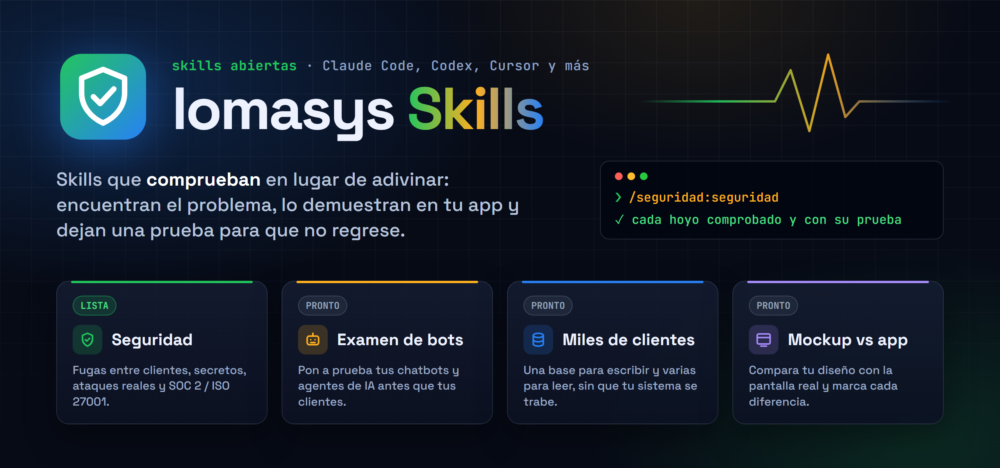

<div align="center">



<br>

[](LICENSE)
[](#-instalación)
[](#otras-herramientas-codex-cursor-copilot-gemini)
[](#)

**Skills para desarrolladores que entregan software en serio.**
No te dan una lista de "posibles problemas": **lo comprueban en tu app, te lo demuestran y dejan una prueba para que no regrese.**

[Instalar](#-instalación) · [Skills](#-índice-de-skills) · [Pruébala en 2 minutos](#-pruébala-en-2-minutos) · [Cómo funciona](#-cómo-funciona-seguridad) · [Preguntas](#-preguntas-frecuentes)

</div>

---

## ⚡ Instalación

Cada skill se instala **por separado**: instalas solo las que quieres.

### Claude Code

**1. Agrega este catálogo (solo la primera vez):**

```text
/plugin marketplace add lomasys/skills
```

**2. Instala la skill que quieras:**

```text
/plugin install seguridad@lomasys-skills
```

Listo. Abre cualquier proyecto y escribe `/seguridad:seguridad`, o pídelo con tus palabras: *"revisa la seguridad de este proyecto"*.

¿Prefieres la terminal? Es lo mismo con `claude plugin marketplace add …` y `claude plugin install …`.

> [!TIP]
> Para ver todas las skills disponibles escribe `/plugin` y entra a **lomasys-skills**. Las actualizaciones te llegan con `/plugin marketplace update lomasys-skills`.

### Otras herramientas (Codex, Cursor, Copilot, Gemini…)

Un comando por skill. Detecta qué herramientas tienes y te pregunta dónde instalarla:

```bash
npx skills add lomasys/skills --skill seguridad
```

### A mano

```bash
git clone https://github.com/lomasys/skills.git
```

Copia la carpeta `plugins/seguridad/skills/seguridad` a la carpeta de skills de tu herramienta:

| Herramienta | Para ti (todos tus proyectos) | Solo para un proyecto (y tu equipo) |
|---|---|---|
| Claude Code | `~/.claude/skills/seguridad/` | `.claude/skills/seguridad/` |
| Codex, Copilot CLI, Gemini CLI | `~/.agents/skills/seguridad/` | `.agents/skills/seguridad/` |

---

## 📋 Índice de skills

| | Skill | Qué resuelve | Estado |
|---|---|---|---|
| 🛡️ | [**Seguridad**](plugins/seguridad/skills/seguridad/SKILL.md) | Encuentra hoyos de seguridad, **los comprueba atacando tu app en tu máquina**, deja una prueba que evita que regresen y marca qué control de SOC 2 / ISO 27001 toca cada uno. | ✅ Lista |
| 🤖 | Examen de bots | Pone a prueba tus chatbots y agentes de IA: inyección de instrucciones, fugas de datos, respuestas inventadas. | 🔜 Pronto |
| 🗄️ | Base para miles de clientes | Una base de datos para escribir y varias para leer, paso a paso, sin que el sistema se trabe. | 🔜 Pronto |
| 🎨 | Mockup contra pantalla | Compara tu diseño con la pantalla real y marca cada diferencia. | 🔜 Pronto |

---

## 🛡️ Cómo funciona: Seguridad

### Qué la hace distinta

| Lo que ya existe | Lo que le falta | Lo que hace esta skill |
|---|---|---|
| Escáneres de código (Semgrep, CodeQL, Brakeman) | Dan cientos de avisos de "posible problema"; muchos son falsos | **Solo reporta lo que pudo comprobar**, con la petición exacta como prueba |
| `/security-review` y revisiones con IA | Leen el código y opinan; no prueban nada | **Levanta tu app y la ataca** como lo haría alguien de fuera |
| Herramientas de secretos y dependencias | Revisan una sola cosa cada una | Las usa si las tienes y **junta todo en un solo reporte** |
| Nadie | No saben qué es un "cliente" en tu sistema | **Entiende tu modelo de cuentas** y busca dónde un cliente puede ver datos de otro |
| Nadie | El hoyo se arregla… y regresa meses después | **Deja una prueba automática** que falla si alguien lo vuelve a meter |
| Consultoras de SOC 2 / ISO | La evidencia técnica se arma a mano | **Marca qué control toca cada hallazgo** y arma el reporte de evidencias |

### Qué revisa

1. **Fuga entre cuentas.** Que un cliente no pueda ver ni cambiar datos de otro cliente.
2. **Permisos.** Que un usuario no pueda hacer cosas de un rol que no tiene.
3. **Enlaces públicos.** Qué muestran, si caducan y si se pueden adivinar.
4. **Secretos.** Claves y tokens escritos en el código.
5. **Entradas peligrosas.** Inyección SQL, XSS, redirecciones abiertas y archivos sin validar.
6. **Login y abuso.** Límite de intentos y cookies seguras.
7. **Webhooks.** Que validen la firma y no procesen dos veces el mismo aviso.
8. **Dependencias.** Paquetes con fallas conocidas, y si de verdad usas la parte que falla.
9. **Configuración.** Encabezados de seguridad, HTTPS y CORS.

### Cómo se usa

| Escribes | Hace |
|---|---|
| `/seguridad:seguridad` | Revisa todo el proyecto |
| `/seguridad:seguridad cambios` | Revisa solo lo que modificaste, antes de subirlo |
| `/seguridad:seguridad cuentas` | Revisa un solo tema (`cuentas`, `permisos`, `webhooks`, `secretos`…) |
| `/seguridad:seguridad auditoria` | Reporte de controles técnicos para SOC 2 / ISO 27001 / ISO 27701 |

También puedes pedirlo con tus palabras: *"revisa si un cliente puede ver datos de otro"*.

### Así se ve un hallazgo

> 🔴 **Grave: un cliente puede leer y cambiar los tableros de otro**
> `GET /api/tableros/:id` y `PATCH /api/tableros/:id` · `server.js:85`
>
> **Lo comprobé:** con la sesión de Ana (Empresa A) pedí el tablero 2 (Empresa B) → `200` con *"Nómina Empresa B"*.
> **Quién lo aprovecha:** cualquier usuario con cuenta, cambiando un número en la URL.
> **Arreglo:** buscar el tablero dentro de la cuenta del usuario (`b.accountId === user.accountId`).
> **Prueba agregada:** `test/seguridad/aislamiento-tableros.test.js`: falla hoy y pasa con el arreglo.
> **Controles:** ISO 27001 8.3 · SOC 2 CC6.1

### Lo que nunca hace

- **Nunca ataca producción** ni ningún servidor que no sea tu máquina o Docker local.
- **Nunca arregla nada sin preguntarte.** Te propone el cambio y tú decides.
- **Nunca dice "cumples SOC 2 o ISO".** Eso solo lo puede decir un auditor. Te da la evidencia técnica y te lista lo que falta fuera del código.

---

## 🧪 Pruébala en 2 minutos

Este repositorio trae [**Tablero Vulnerable**](demo/tablero-vulnerable), una mini app con hoyos **puestos a propósito**. No necesita instalar nada, solo Node 18 o más nuevo.

```bash
git clone https://github.com/lomasys/skills.git
cd skills/demo/tablero-vulnerable
claude
```

Y dentro de Claude Code:

```text
/seguridad:seguridad
```

Vas a ver cómo encuentra los hoyos, los comprueba uno por uno y escribe las pruebas.

> [!CAUTION]
> Tablero Vulnerable es inseguro a propósito. Solo escucha en `127.0.0.1`. No la subas a ningún servidor.

---

## 📂 Estructura

```text
skills/
├── .claude-plugin/
│   └── marketplace.json        ← catálogo: una entrada por skill
├── plugins/
│   └── seguridad/              ← cada skill es su propio plugin
│       ├── .claude-plugin/plugin.json
│       └── skills/seguridad/
│           ├── SKILL.md        ← las instrucciones de la skill
│           └── referencias/    ← cómo atacar cada tipo de hoyo, reglas SOC 2 / ISO
├── demo/
│   └── tablero-vulnerable/     ← app de práctica con hoyos a propósito
└── assets/                     ← portada
```

---

## ❓ Preguntas frecuentes

<details>
<summary><b>¿Funciona con mi lenguaje o framework?</b></summary>

Sí. La revisión de código sirve para cualquier lenguaje. Para el ataque comprobado, la skill necesita poder levantar tu app en tu máquina (`npm start`, `rails s`, `docker compose up`, etc.). Si no puede, hace solo la revisión de código y te avisa qué no pudo comprobar.
</details>

<details>
<summary><b>¿Manda mi código a algún lado?</b></summary>

No. La skill solo son instrucciones para tu agente. Tu código se queda donde ya lo procesa tu agente de IA, igual que en cualquier otra tarea.
</details>

<details>
<summary><b>¿Reemplaza una auditoría o un pentest profesional?</b></summary>

No. Encuentra y demuestra los errores más comunes en el código antes de que lleguen a producción, y te da evidencia técnica ordenada. Una certificación SOC 2 o ISO 27001 también revisa procesos, políticas y personas, y la otorga un auditor.
</details>

<details>
<summary><b>¿Por qué se escribe <code>/seguridad:seguridad</code> y no solo <code>/seguridad</code>?</b></summary>

Claude Code pone el nombre del plugin delante de sus skills para que no choquen con otras. Si la instalas a mano en `~/.claude/skills/`, se usa como `/seguridad`.
</details>

---

## 🤝 Contribuir

¿Encontraste un tipo de hoyo que la skill no detecta? Abre un *issue* con un ejemplo mínimo. Si puedes, agrégalo también a `demo/tablero-vulnerable` para que quede probado.

## 📄 Licencia

[Apache 2.0](LICENSE). Úsala, modifícala y compártela.

<div align="center">
<br>
<sub>Hecho por <b>lomasys</b></sub>
</div>

